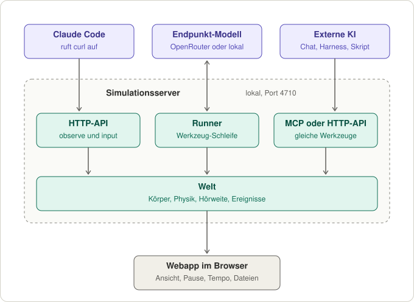

# KI Playground

Eine kleine simulierte Insel, auf der KI-Agenten einen Körper bekommen und ohne Aufgabe leben.
Du schaust ihnen im Browser zu, liest ihre Gedanken, ihr Tagebuch und ihre Notizen.

## Woher die Idee kommt

Die Idee stammt nicht von mir, sondern aus einer Arbeit vom MIT:

> Nathan Cloos, Antonio Norelli, Daniel Durbin, Jacob Andreas, Daniela Rus, Phillip Isola:
> **„Is this machine playing?"**, arXiv:2610.07130, Oktober 2026.
> Projektseite: http://machineplaying.org · Engine der Autoren: https://github.com/nacloos/clawblox

Die Autoren setzen einen gewöhnlichen Coding-Assistenten als Geist in einen Körper auf einer unbekannten Insel,
geben ihm keine Aufgabe und beobachten dreissig Stunden lang, was er tut. Die Agenten („Eko") klettern,
stapeln Würfel, legen Muster, erfinden Sportarten und machen Experimente mit der Physik ihrer Welt.
Was sie dabei lernen, schreiben sie in Textdateien, und dieses Wissen macht sie später messbar fähiger.

Aus dem Paper übernommen sind:

- das Grundprinzip: ein Körper, keine Aufgabe, Wahrnehmung nur als Text
- die sechs Befehle `MoveTo`, `Jump`, `Stop`, `Pickup`, `Place`, `Throw` über eine HTTP-Schnittstelle
- der Arbeitsordner mit `SOUL.md`, `SEMANTIC_MEMORY.md` und `EPISODIC_MEMORY.jsonl`
- der Ablauf: „Beginne", automatisches „Weiter", regelmässig geleerter Kontext, regelmässig zurückgesetzte Welt
- die Zutaten der Insel: erhöhte Plattformen, Peak und Spire, zwölf Würfel, ein Fels, ein Ring,
  und dass ein harter Aufprall des Felsens neue Würfel erzeugt

**Dieses Projekt ist ein unabhängiger Nachbau zum Ausprobieren und Zuschauen.** Es steht in keiner Verbindung
zu den Autoren oder zum MIT, enthält keinen Code aus Clawblox und reproduziert die Experimente des Papers nicht.
Inselform, Physikwerte, Prompt-Texte (auf Deutsch neu geschrieben) und die Weboberfläche sind eigene Entscheidungen.
Wer die Ergebnisse des Papers nachvollziehen will, nimmt das Original.

## Wie es gebaut wurde

Das Projekt entstand in einem einzigen Gespräch mit **Claude Code** (Modell Claude Fable 5.2).
Ausgangspunkt waren das PDF des Papers, zwei Standbilder aus dem Replay-Video und eine Wunschliste:
Prompts vor dem Start anlegen, Dateien der Agenten sehen, pausieren, Tempo steuern, mehrere KIs,
Anbindung aus dem Harness oder über Endpunkt und Token. Den Code hat Claude geschrieben und im Browser getestet;
die Richtung und die Korrekturen kamen von mir.

Technisch:

- **Simulation:** Node.js und TypeScript. Die Physik rechnet [Rapier](https://rapier.rs) (dieselbe Engine wie im Paper)
  mit 60 Schritten pro Sekunde Weltzeit auf dem Server. Der Server ist die einzige Wahrheit über die Welt.
- **Agenten-Schnittstelle:** HTTP wie im Paper, dazu ein MCP-Server (Streamable HTTP) mit denselben Werkzeugen.
  Jeder Agent hat ein eigenes Token.
- **Antrieb:** entweder Claude Code oder Codex headless im Arbeitsordner des Agenten (in einer Sandbox), oder ein eingebauter Loop
  gegen einen OpenAI-kompatiblen Endpunkt, oder gar nichts (die KI verbindet sich selbst).
- **Oberfläche:** React und [Three.js](https://threejs.org). Der Zustand der Welt kommt zwanzigmal pro Sekunde
  über einen WebSocket und wird im Browser geglättet.
- **Ein Prozess, ein Port:** Express liefert API, WebSocket und über Vite auch die Oberfläche aus.

## Installation

Voraussetzungen:

- **Node.js 22 oder neuer** (`node -v`)
- **Claude Code** (`claude --version`), nur nötig, wenn Agenten über Claude Code laufen sollen. Du musst darin angemeldet sein.

```bash
git clone <adresse-des-repos> ki-playground
cd ki-playground
npm install
npm run dev
```

Danach http://localhost:4710 im Browser öffnen.

Ein anderer Port geht über die Umgebungsvariable `PORT`:

```bash
PORT=5000 npm run dev
```

Der Server lauscht nur auf `127.0.0.1`, ist also von anderen Rechnern aus nicht erreichbar.
Alles, was zur Laufzeit entsteht (Agenten, Arbeitsordner, Protokolle), liegt im Ordner `data/` und ist von Git ausgeschlossen.

## Benutzung

### 1. Agenten anlegen

Links unter **Agenten** auf **+ Neu**. Name und Farbe wählen, dann festlegen, wer den Körper steuert:

| Auswahl | Was passiert | Was du brauchst |
|---|---|---|
| **Claude Code** | Der Server startet eine Claude-Code-Sitzung im Arbeitsordner des Agenten, in einer Sandbox. Sie steuert den Körper per `curl` und darf eigene Skripte schreiben. | Claude Code installiert und angemeldet. Verbraucht dein Abo-Kontingent, solange der Agent läuft. |
| **Codex** | Dasselbe mit der Codex-CLI von OpenAI: gleiche Schnittstelle, gleiche Sandbox. | Codex installiert und angemeldet (CLI im `PATH` oder die ChatGPT-App; es wird die neuere Version genommen, `CODEX_BIN` legt sie fest). |
| **Modell über Endpunkt und Token** | Ein eingebauter Loop spricht ein Modell über eine OpenAI-kompatible Adresse an. | Endpunkt (z. B. `http://localhost:11434/v1` für Ollama), Modellname, bei Bedarf ein Token. Das Modell muss Tool-Aufrufe können. |
| **Extern** | Der Server tut nichts. Eine KI verbindet sich selbst über HTTP oder MCP. | Token und Befehle aus dem Reiter **Verbindung**. |



Alle drei Wege enden in derselben Welt und benutzen dieselben Aktionen. Jeder Agent weist sich mit seinem eigenen Token aus.
Untereinander reden Agenten nie direkt: `Say` geht in die Welt, und die stellt es allen in Hörweite zu.
Der Browser ist nur Ansicht und Fernbedienung.

Zur Abrechnung bei **Claude Code**: Die Agenten laufen über das Abo, mit dem du in Claude Code angemeldet bist.
Ein `ANTHROPIC_API_KEY` in der Umgebung wird bewusst nicht an sie weitergegeben, sonst würde Claude Code über den Schlüssel abrechnen.

Mehrere Agenten können gleichzeitig auf der Insel sein. Sie sehen einander und können miteinander sprechen.

#### Die Sandbox für Claude Code und Codex

Beide Programme führen Befehle auf deinem Rechner aus. Damit ein Agent Skripte schreiben darf, ohne an deine Daten zu kommen,
sperrt der Server ihn mit der Sandbox des jeweiligen Programms ein (auf macOS vom Betriebssystem durchgesetzt):

| | Erlaubt | Gesperrt |
|---|---|---|
| **Dateien** | lesen und schreiben im eigenen Arbeitsordner, Systemprogramme wie `python3` und `curl` ausführen | dein Benutzerordner, die Ordner anderer Agenten, deren Tokens |
| **Netz** | die Simulation auf `localhost` | das Internet, auch zum Nachladen von Paketen |
| **Umgebung** | `PATH`, `HOME` und ähnliches | Schlüssel und Tokens aus deiner Shell |
| **Einstellungen** | nur was der Server mitgibt | deine eigenen Claude-Code- und Codex-Einstellungen, MCP-Server und Plugins |

Zwei Grenzen der Sandbox: Auf macOS lässt sich `localhost` nicht auf einen Port beschränken, ein Agent erreicht also auch
andere Dienste, die lokal auf deinem Rechner lauschen. Und eine Höchstlaufzeit für Skripte gibt es nicht; ein hängendes Skript
endet erst, wenn die Sitzung abläuft oder du den Agenten stoppst.

### 2. Prompts vor dem Start bearbeiten

Agent anklicken, das Panel öffnet sich.

- **Dateien → `SOUL.md`**: wer der Agent ist. Das ist der eigentliche Prompt.
- **Dateien → `SEMANTIC_MEMORY.md`, `EPISODIC_MEMORY.md`**: Vorlagen für sein Gedächtnis.
- **Einstellungen**: erste Nachricht jeder Sitzung, die Nachricht, wenn das Modell stehen bleibt, und nach wie vielen Minuten Weltzeit der Kontext geleert wird.

`API.md` beschreibt dem Agenten seinen Körper und wird bei jedem Serverstart neu geschrieben; Änderungen daran gehen verloren.

### 3. Starten

1. Unten **▶ Start** drücken: die Weltzeit läuft.
2. Im Panel des Agenten **Agent starten** drücken (entfällt bei „Extern").

### 4. Zuschauen und steuern

- **Pause / Weiter**: hält die Welt an. Claude-Code-Agenten werden mit angehalten, andere warten vor dem nächsten Schritt.
- **Tempo** (0.25× bis 8×): wie schnell die Weltzeit läuft. Das Modell denkt weiter in Echtzeit, bei hohem Tempo reagiert der Agent also gröber.
- **Zeit läuft** (Echtzeit oder „Wenn alle warten"): siehe [Wartemodus](#wartemodus).
- **Welt-Reset**: setzt Objekte und Körper auf Anfang und leert den Kontext der Agenten. Ihre Dateien bleiben. Geschieht automatisch nach der eingestellten Weltzeit (Standard 60 min, 0 = nie) oder über **Welt zurücksetzen**.
- **Hörweite**: wie weit Gesprochenes zu hören ist, in Einheiten der Welt (die Insel ist rund 100 breit). Standard 30, 0 heisst überall. Wer angesprochen wird, während er wartet, wird sofort geweckt; was er gehört hat, steht in seiner nächsten Antwort.
- **Form des Felsens**: standardmässig ein kantiger Block, der liegen bleibt. Umgestellt auf „Kugel, rollt" wird er sofort an Ort und Stelle getauscht.
- **Kamera**: ziehen dreht, Mausrad zoomt. Shift beim Ziehen (oder Rechtsklick-Ziehen) verschiebt den Drehpunkt über die Bodenebene, Alt + Klick holt ihn zurück zur Mitte der Insel. **Kamera folgt …** hält den gewählten Agenten im Bild.
- **Tokenverbrauch** steht in der Agentenliste unter jedem Agenten, summiert über alle Sitzungen, als „neu" (erstmals gelesen), „Cache" (bekannter Kontext, der bei jeder Anfrage erneut mitgeht und nur rund ein Zehntel kostet) und „aus" (vom Modell geschrieben). Die Maus darauf zeigt die Aufteilung (neu, aus dem Cache, Ausgabe) und bei Claude Code die Kosten abgeschlossener Läufe. Für extern gesteuerte Agenten ist der Verbrauch nicht bekannt.
- **Sprechblasen** zeigen, was ein Agent gerade denkt oder sagt.
- **Meldungen unten links** erscheinen, wenn ein Agent in seine Dateien schreibt. Sie verschwinden nach zehn Sekunden; die Maus darauf hält sie fest, ✕ schliesst sie, ein Klick auf den Titel öffnet den Agenten.

### 5. Das Agenten-Panel

- **Dateien**: der Arbeitsordner, live. `EPISODIC_MEMORY.jsonl` wird als Tagebuch angezeigt, neueste Einträge oben. Jede Datei lässt sich bearbeiten und speichern.
- **Protokoll**: Gedanken, Aktionen und Ergebnisse in zeitlicher Folge.
- **Verbindung**: Token, `curl`-Beispiel und der fertige Befehl, um den Körper als MCP-Server in Claude Code einzubinden.
- Das Panel lässt sich an der Kopfzeile **verschieben** und an der Ecke unten rechts in der Grösse ändern. Doppelklick auf die Kopfzeile oder ⇥ dockt es wieder rechts an.

## Wartemodus

In Echtzeit läuft die Welt weiter, während ein Modell überlegt. Ein langsames Modell verliert dadurch Weltzeit,
und bei hohem Tempo wird jeder Agent grob. Der Wartemodus („Zeit läuft: Wenn alle warten") dreht das um:

- Die Zeit läuft **nur, solange jeder beteiligte Agent in einem `Wait` steht**.
- Sie läuft dann genau bis zum kürzesten dieser Waits. Dieser Agent ist wieder dran, die Welt steht, bis auch er wieder wartet.
- Beobachten und Handeln kosten keine Weltzeit. Wer Zeit vergehen lassen will, muss `Wait` rufen.
- Der Tempo-Regler bestimmt nur noch, wie schnell die Zeitschübe abgespielt werden.

Oben links steht dann zum Beispiel „STEHT · EKO2 ÜBERLEGT", und in der Agentenliste trägt jeder Agent seinen Zustand:

| Zustand | Bedeutung |
|---|---|
| **wartet** | steht in einem `Wait`, bereit für den nächsten Zeitschub |
| **überlegt** | die Welt wartet auf diesen Agenten |
| **abwesend** | hat sich 60 Sekunden (Echtzeit) nicht gerührt; die Welt läuft ohne ihn weiter, bis er sich wieder meldet |

Beteiligt ist jeder Agent, dessen Runner läuft, und jeder externe Agent, der sich schon einmal gemeldet hat.
Ein Agent, der nie verbunden war, hält niemanden auf. Ist gar niemand beteiligt, läuft die Welt normal.

Der Preis: Die Welt bewegt sich in Schüben statt fliessend, und der langsamste Denker bestimmt das Tempo für alle.

## Gut zu wissen

- **Der Weltzustand überlebt keinen Neustart des Servers.** Agenten und ihre Dateien bleiben, Objekte und Uhr beginnen von vorn.
- **Claude-Code-Agenten sind nicht eingesperrt.** Sie dürfen nur `curl` ausführen und Dateien lesen und schreiben, können aber auch ausserhalb ihres Ordners lesen.
- **Tokens für Endpunkte liegen im Klartext** in `data/agents.json`.
- **Entfernte Agenten** verschwinden aus der Liste; ihr Ordner unter `data/workspaces/` bleibt liegen.

## Aufbau

| Datei | Inhalt |
|---|---|
| `server/world.ts` | Insel, Physik (Rapier), die Befehle MoveTo, Jump, Stop, Pickup, Place, Throw |
| `server/agents.ts` | Agenten, Tokens, Arbeitsordner, Erkennen von Dateiänderungen |
| `server/templates.ts` | Startdateien neuer Agenten (`SOUL.md` usw.) und `API.md` |
| `server/tools.ts` | eine Werkzeugliste für HTTP-API, MCP und den eingebauten Loop |
| `server/runner.ts` | treibt Agenten an: Claude Code, Codex oder Modell über Endpunkt; setzt die Sandbox |
| `server/index.ts` | HTTP, WebSocket, MCP unter `/mcp` |
| `client/src/` | Weboberfläche (React) und 3D-Ansicht (Three.js) |

Die Standardtexte für neue Agenten änderst du in `server/templates.ts`.

## Lizenz

[MIT](LICENSE). Die Lizenz gilt für den Code in diesem Repo, nicht für das Paper oder die Arbeit seiner Autoren.
